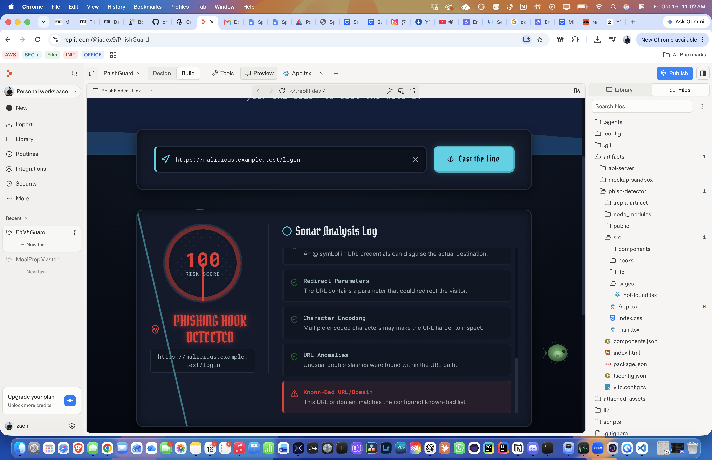

# Sprint 3 — US10 Testing Evidence

**Project:** PhishGuard  
**Course:** FIU Capstone 2 — CIS 4951  
**Sprint:** 3  
**Date:** October 16, 2026  
**Story:** US10 — Reweight URL Risk Checks and Implement Known-Bad List Detection  
**Owner:** Zachariah Omar Melendez-Martinez

## Objective

Improve PhishGuard's URL risk scoring by assigning severity-based weights to the existing 12 checks, implementing known-bad URL/domain detection, and correcting the URL shortener false positive identified in TC03 during Sprint 2.

## Implementation Summary

The URL analysis function in `artifacts/phish-detector/src/App.tsx` was updated with:

- Weighted scoring for all 12 existing phishing indicators.
- An additional known-bad URL/domain check using a local demonstration list.
- Risk-based thresholds instead of classifications based only on the number of flagged checks.
- A combination rule that escalates the verdict when brand impersonation and phishing keywords appear together.
- Improved low-risk wording from "SAFE CATCH" to "LOW RISK DETECTED."

The scoring engine analyzes the URL text without visiting the destination or expanding shortened links.

## TC01–TC05 Regression Testing

| Test | URL | Sprint 2 Score | Sprint 3 Score | Sprint 3 Verdict |
|---|---|---|---|---|
| TC01 | `https://www.youtube.com` | 0 | 0 | Low Risk |
| TC02 | `http://example.com` | 12 | 5 | Low Risk |
| TC03 | `https://bit.ly/example` | 12 | 5 | Low Risk |
| TC04 | `http://secure-login.paypa1.com` | 38 | 40 | Phishing |
| TC05 | `https://example.xyz` | 12 | 5 | Low Risk |

All five test cases were rerun using the updated application. The observed results matched the revised scoring rules.

### TC03 — URL Shortener False Positive

In Sprint 2, `https://bit.ly/example` was classified as Suspicious because URL shorteners automatically triggered a warning.

Following the update, the same URL received a risk score of 5 with a Low Risk verdict. URL shortening is still flagged and explained, but does not independently produce a Suspicious verdict.

This addresses the identified false positive. The actual shortened destination remains unverified.

### TC04 — Brand Impersonation

The test URL `http://secure-login.paypa1.com` initially received a score of 40 and a Suspicious verdict under the new weighted scoring system.

An additional combination rule was introduced to classify URLs containing both brand impersonation and phishing keywords as Phishing.

After the update, TC04 retained its score of 40 but produced the Phishing verdict. This demonstrates that strong indicator combinations can influence the final classification.

## Known-Bad List Testing
### Test Evidence

**Test URL:** `https://malicious.example.test/login`

**Observed score:** 100  
**Observed verdict:** Phishing

The test confirmed that an entry configured in the local demonstration blocklist receives a high-risk classification.

This test validates the demonstration blocklist behavior only. A maintained real-world malicious URL feed has not yet been integrated.

## Additional Testing

Preliminary checks were also performed using:

- `https://example.com` — Score 0, Low Risk
- `https://paypa1.com` — Score 25, Suspicious
- `https://bit.ly/example` — Score 5, Low Risk

These outputs matched the proposed scoring rules.

## Limitations and Future Improvements

- The known-bad list currently contains demonstration entries, not a production threat-intelligence feed.
- Scoring weights and thresholds are heuristic values and require broader validation.
- Shortened URLs are not expanded or independently verified.
- Low Risk does not guarantee that a URL is safe.
- Further testing is needed for false positives, false negatives, malformed URLs, and legitimate URLs containing multiple warning indicators.

## Conclusion

The Sprint 3 US10 implementation successfully introduced weighted URL scoring, corrected the TC03 shortener classification, added a demonstration known-bad detection check, and improved TC04 phishing classification through a combination rule.

The five original regression cases were rerun and documented. Final acceptance remains subject to team review, additional validation, and confirmation that the demonstration blocklist meets the agreed acceptance criteria.
